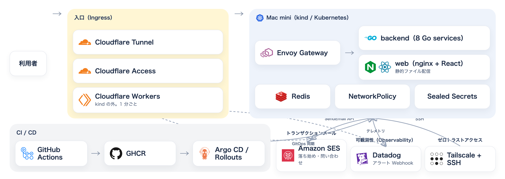
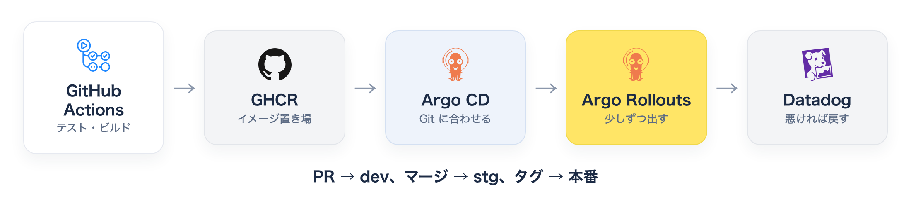
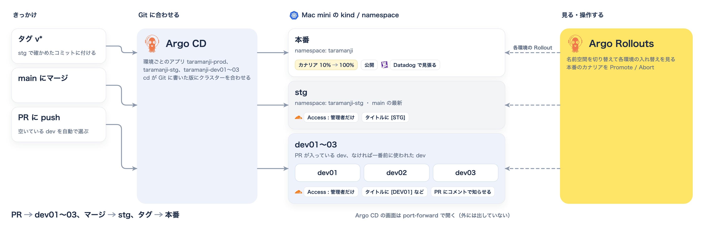
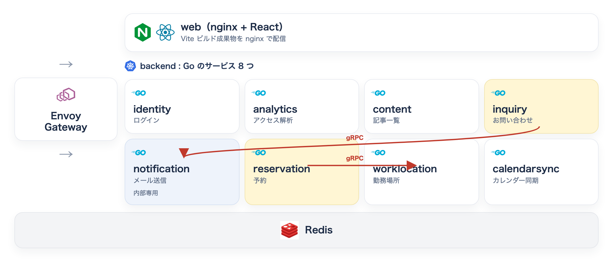
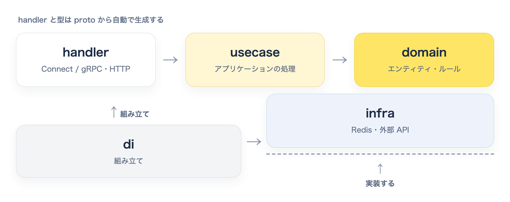
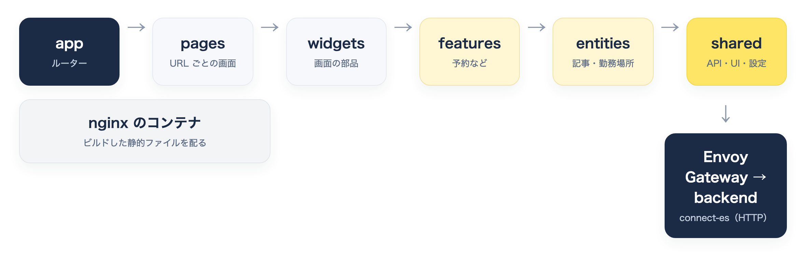
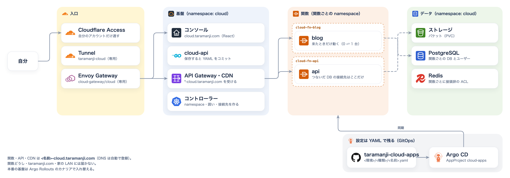

<!-- 1. GitHub usernameを変更 -->

  

<!-- 2. プロフィールや連絡先を変更 -->
##  Hi there

- 🧑‍💻 I'm a backend engineer.
- 📫 How to reach me: [taramanji.com](https://taramanji.com)
 

<!-- 3. 好きな技術スタックに変更 -->
<!-- ライトモート：theme=light, ダークモート：theme=dark -->
<!-- アイコンの選択肢一覧：https://arc.net/l/quote/zizyykfh -->
## 🌱 Skills

 

<!-- 4. GitHub usernameを変更, 2箇所 -->
<!-- ライトモート：theme=light, ダークモート：theme=vue-dark  -->
## 🏃‍♀️ Activities

  
  

 

---

## 🏠 taramanji.com と taramanji cloud

自宅の Mac mini（M4）1 台の中の Kubernetes で、2 つのものを動かしています。

| | 何か | URL |
|---|---|---|
| **taramanji.com** | ポートフォリオ・予約・お問い合わせ・カレンダー同期（gws） | [taramanji.com](https://taramanji.com) ・ gws.taramanji.com |
| **taramanji cloud** | 自分専用の小さなクラウド（関数・API Gateway・ストレージ・CDN・データベース・シークレット） | cloud.taramanji.com（自分だけ） |

### いまのサーバー

| | |
|---|---|
| マシン | Mac mini（M4）。OrbStack の VM 1 つ（メモリ 11.7 GiB） |
| Kubernetes | kind 1.34（ノード 3 台）。メモリはふだん 6.5 GiB ほど使う |
| GitOps | Argo CD 3.5（main を見て同期）・Argo Rollouts 1.10（本番のカナリア）・Sealed Secrets |
| 入口 | Cloudflare Tunnel → Envoy Gateway 1.9（Gateway API）。ルーターのポートは開けていない |
| 監視 | Datadog（メトリクス・APM・ログ）・Cloudflare Workers（外から 1 分ごとに見る） |
| 版 | v0.2.14 |

| namespace | 中身 |
|---|---|
| `taramanji` / `taramanji-stg` / `taramanji-dev01`〜`03` | taramanji.com の本番 / stg / dev（PR ごと） |
| `data` | Redis（taramanji.com のデータ） |
| `gateway`・`envoy-gateway-system`・`cloudflared` | taramanji.com の入口 |
| `taramanji-cloud` / `taramanji-cloud-stg` / `taramanji-cloud-dev` | taramanji cloud の基盤（コンソール・API Gateway・ストレージ・データベース）の本番 / stg / dev |
| `taramanji-cloud-apps`・`taramanji-cloud-fn-<名前>` | taramanji cloud のアプリの定義と、関数ごとの namespace（アプリは本番だけ） |
| `taramanji-cloud-gateway`・`taramanji-cloud-cloudflared` | taramanji cloud の入口（taramanji.com とは別） |
| `argocd`・`argo-rollouts`・`datadog` | 運用 |

### インフラ・使っている技術

- 管理画面（`/admin`・gws の管理画面・stg・dev・Argo Rollouts の画面・taramanji cloud）は、Cloudflare Access で自分だけが入れる
- 落ちたら、Cloudflare Workers（kind の外）が SES のメールと Discord で知らせる。Datadog の通知も同じ Worker が受ける
- 家のサーバーが落ちているときは、Cloudflare Workers が「メンテナンス中」の画面を返す（`deploy/cloudflare/maintenance`）
- 外からの作業は Tailscale ＋ SSH

### リリースの流れ（CI / CD）

- PR → dev01〜03（cloud は taramanji-cloud-dev）、main にマージ → stg、タグ（`v*`）→ 本番
- dev は PR を出したときだけ動き、その PR を閉じると 0 台に戻る（kind のメモリを空けておく）
- 本番はカナリア（Argo Rollouts）
  - taramanji.com: 10%（Promote 待ち）→ 25% → 50% → 100%。Datadog で 5xx 率と p95 を見て、悪ければ自動で元に戻す
  - taramanji cloud の基盤（cloud-api・cloud-gw・console）: 1 台（50%）で Promote 待ち。cloud-api は 5xx 率で自動で戻す
- **変わったサービスだけ**ビルドして入れ替える。Go は依存関係（`go list -deps`）で判定し、共通部分の変更は使う全サービスが対象

### 環境と管理画面

### バックエンド（`backend/`：Go・Connect / gRPC）

各サービスは同じ層の形（DDD ＋ クリーンアーキテクチャ）です。

### フロントエンド（`frontend/`：React ＋ Vite ＋ TypeScript）

---

## ☁️ taramanji cloud

AWS のコンソールのように使える、自分専用の小さなクラウドです。コンソール（[cloud.taramanji.com](https://cloud.taramanji.com)）から作ったものは、すべて Kubernetes の YAML として git に残ります。

 

| | サービス | AWS でいうと | できること |
|---|---|---|---|
|  | Functions | Lambda | コンテナイメージを、リクエストが来たときだけ動かす（0 ⇄ 1 台） |
|  | API Gateway | API Gateway | `<名前>-apigw-cloud.taramanji.com` のパスごとに関数へ渡す（ログインあり） |
|  | CDN | CloudFront | バケットや API Gateway を `<名前>-cdn-cloud.taramanji.com` で自分だけに出し（ログインあり）、Cloudflare にキャッシュさせる。パスごとに元を分けられる |
|  | Storage | S3 | ファイルを置くバケット。ドラッグ&ドロップでフォルダーごと置ける。公開をオンにすると `<バケット>-storage-cloud.taramanji.com` でログインなしに配る |
|  | Databases | RDS / ElastiCache | PostgreSQL と Redis を切り出して、関数につなぐ |
|  | Capacity | — | インスタンスタイプ（汎用 `t1`・コンピューティング最適化 `c1`・メモリ最適化 `r1`）があと何個置けるか |
|  | Metrics | CloudWatch | リクエスト・エラー・CPU・メモリ（本番だけ） |
|  | Guide | — | しくみの説明とチュートリアル（コンソールの中） |

- **切り離し**: トンネル・Gateway・Cloudflare Access のアプリを taramanji.com と分けている。関数などはデプロイヤー（cloud-ctl）が YAML から入れる（Argo CD は入れない。Argo CD の画面では関数ごとに Pod が動いているかだけ見られる）。taramanji の Secret・セッション・Redis は使わない
- **関数ごとの namespace**: 関数は 1 つずつ `taramanji-cloud-fn-<名前>` で動く。namespace と囲い（Quota・NetworkPolicy・Pod Security・権限）はコントローラーが作り、YAML のリポジトリからは作れない
- **接続先**: データベースとバケットのパスワード・トークンは、つないだ関数の namespace にだけ置く。git にもコンソールにも出ない
- **入口ごとのログイン**: コンソール・CDN（`<名前>-cdn-cloud`）・API Gateway（`<名前>-apigw-cloud`）は Cloudflare Access の後ろ（自分だけ）。公開バケット（`<バケット>-storage-cloud`、既定はオフ）だけログインなしで配る
- **メモリ**: 関数の合計は本番 2.5 GiB まで（taramanji.com・gws の伸びしろを残す）。足りなくなったら taramanji より先に止まる
- **環境**: アプリ（関数など）は本番だけ。stg・dev には基盤だけを置き、taramanji と同じく stg はいつも、dev は PR のときだけ動く
- **デプロイの様子**: YAML を push すると 15 秒ほどで入り、コンソールの各画面に「デプロイ」の状態と履歴が出る

詳しくは [deploy/cloud/README.md](deploy/cloud/README.md)。

---

## 📁 リポジトリの中身

| ディレクトリ | 中身 |
|---|---|
| `backend/` | Go のサービス（taramanji.com の 8 つと、taramanji cloud の `cloud`）。proto から Connect / gRPC のコードを生成 |
| `frontend/` | taramanji.com の画面（React ＋ Vite） |
| `console/` | taramanji cloud のコンソール（React ＋ Vite） |
| `deploy/k8s/` | taramanji.com のマニフェスト（Kustomize）・Datadog・スクリプト |
| `deploy/cloud/` | taramanji cloud のマニフェスト |
| `deploy/gitops/` | Argo CD・Argo Rollouts と、Argo CD のアプリ定義 |
| `deploy/cloudflare/` | Cloudflare Access・外形監視（uptime）・メンテナンス画面の Worker |
| `deploy/kind/` | kind のクラスターを作るスクリプト |
| `docs/` | この README の図（`docs/diagrams/*.html` から PNG を書き出す） |
